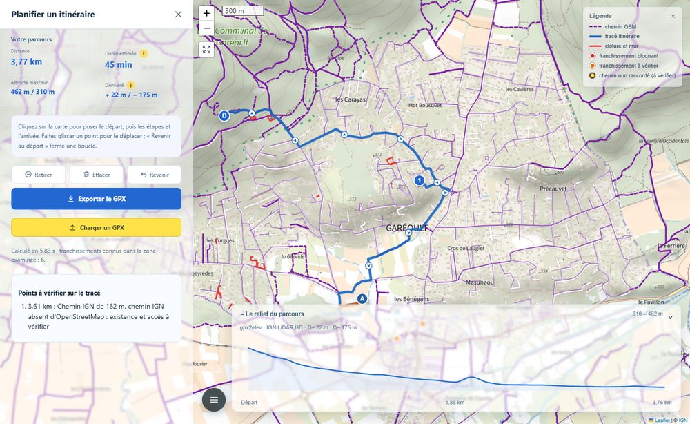
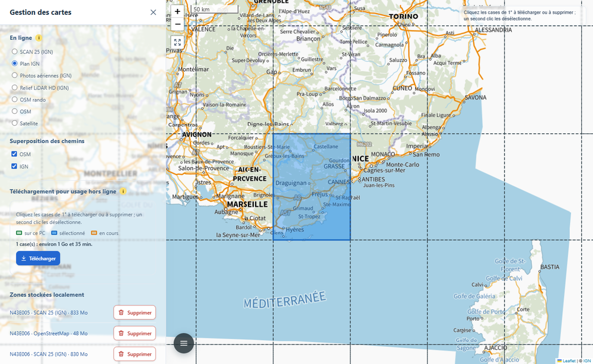
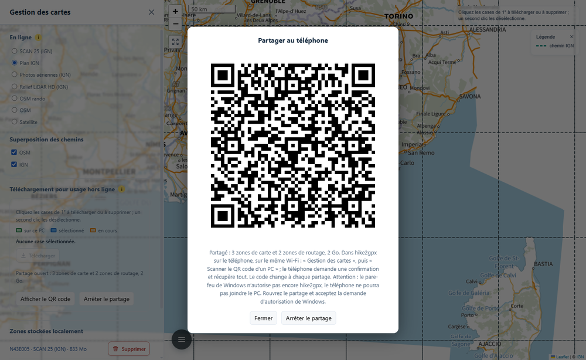
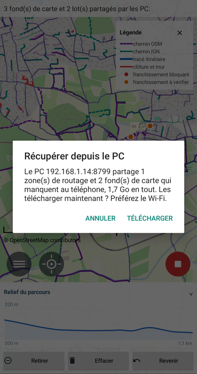
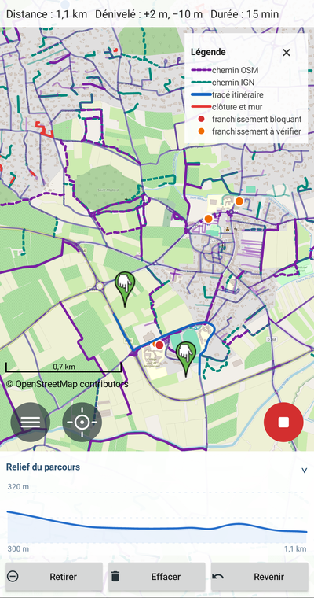

*[English](README.md) | **Français***

# hike2gpx

hike2gpx planifie des randonnées et exporte l'itinéraire en GPX. Il existe en
deux versions qui se complètent : une application pour ordinateur (Windows,
macOS, Linux) et une application Android. L'ordinateur prépare ce que le
téléphone emporte : il fabrique des fonds de carte et des zones de routage,
puis les partage en Wi-Fi par QR code. Le téléphone calcule alors ses
itinéraires hors ligne, en pleine randonnée, sans réseau.

Trois choses le distinguent des planificateurs courants (Visorando, Locus Map,
brouter-web).

**Il respecte les clôtures, les barrières et les portails que décrit
OpenStreetMap.** Ces planificateurs ne les voient pas : leurs moteurs de calcul
ne lisent que les étiquettes posées sur les nœuds du chemin, et une clôture est
une ligne à part. hike2gpx examine d'avance le réseau de la zone, repère chaque
croisement entre un chemin et une barrière, le juge, puis interdit ou décourage
son passage. ([Comment](#le-calcul--brouter-et-les-franchissements),
[un exemple chiffré](#les-chiffres).)

**Il combine OpenStreetMap et les cartes nationales.** Un sentier que l'IGN
connaît et qu'OpenStreetMap ignore n'existe pas pour un moteur qui ne lit que
ce dernier. hike2gpx y ajoute la BD TOPO de l'IGN (France), l'ATKIS
(Allemagne), le swissTLM3D (Suisse), le ZABAGED (Tchéquie) et le BDOT10k
(Pologne). Ce ne sont pas tous les pays, à dessein :
on ne retient que ceux où la carte nationale apporte une part sensible de
chemins nouveaux. ([Comment](#ce-que-contient-une-zone-de-routage),
[les chiffres pays par pays](#les-chiffres).)

**Il calcule le dénivelé sur le terrain, pas sur la cime des arbres.** Sous une
forêt, un modèle de surface comme SRTM ou Copernicus, tirés d'un radar, mesure
plutôt le haut de la canopée, et fausse les pentes. Le LiDAR, lui, envoie des
impulsions laser dont certaines traversent le feuillage jusqu'au sol : on en
tire un vrai modèle numérique de terrain (MNT), le sol nu. hike2gpx prend le
meilleur modèle de terrain qui couvre tout le parcours : en France le LiDAR HD
de l'IGN ; ailleurs Mapterhorn, qui reprend le LiDAR national dès qu'il en
existe un. ([Comment](#le-dénivelé-recalculé-par-gpx2elev),
[la précision mesurée](#les-chiffres).)



## Mode d'emploi

### Installer et relancer

**Sur l'ordinateur**, téléchargez l'archive de votre système dans les
[releases](https://github.com/nico579/hike2gpx/releases), décompressez-la et
lancez `hike2gpx` : la page s'ouvre dans le navigateur. Au tout premier
lancement, hike2gpx pose une icône sur le Bureau ; c'est elle qui le relance
ensuite, après un redémarrage de l'ordinateur par exemple.

Tant qu'il tourne, hike2gpx vit dans la zone de notification (près de
l'horloge sous Windows, dans la barre des menus sous macOS). Fermer l'onglet du
navigateur ne l'arrête pas : un double-clic sur son icône rouvre la page. Son
menu propose « Ouvrir », « Mettre à jour vers x.y » quand une version plus
récente existe, « Redémarrer », « Arrêter », et « Créer un raccourci sur le
Bureau » pour remettre l'icône si vous l'avez effacée. Il se met à jour tout
seul : quand une version plus récente est publiée, un bandeau de la page et ce
menu proposent de l'installer ; il la télécharge, la vérifie, puis redémarre
dessus.

**Sur le téléphone**, installez `hike2gpx-android.apk`, à prendre dans les
mêmes releases (Android demande d'autoriser l'installation depuis cette
source). L'application se relance comme toutes les autres, par son icône.

### Sur l'ordinateur

**Tracer un parcours.** Ouvrez le menu (le bouton à trois traits, en bas à
gauche) puis « Planifier un itinéraire ». Chaque clic sur la carte pose un
point : le départ, les étapes, l'arrivée. L'itinéraire se calcule aussitôt,
avec sa distance, sa durée et son relief ; un point se déplace en le faisant
glisser. « Revenir » referme la boucle sur le départ, « Exporter le GPX »
l'enregistre dans le dossier Téléchargements.

Les pastilles de la carte se cliquent. Une pastille rouge (franchissement
bloquant) ou orange (à vérifier) ouvre une bulle qui dit ce qui barre le
chemin, un portail, une clôture, une barrière, pourquoi hike2gpx l'a jugé
ainsi (« accès interdit ou privé », « portail verrouillé »…), et un lien vers
l'objet dans OpenStreetMap. Une pastille jaune signale un chemin non raccordé :
il s'arrête tout près d'un autre sans le toucher, si bien que le calcul ne
passe pas de l'un à l'autre ; sa bulle donne l'écart et ouvre l'éditeur
d'OpenStreetMap pour le corriger.

**Télécharger une zone de carte.** Dans « Gestion des cartes », choisissez le
fond à emporter (SCAN 25, Plan IGN, OpenStreetMap…), puis cliquez sur la carte
les cases de 1° voulues et « Télécharger ». Les zones de routage, elles, se
prennent dans « Gestion des itinéraires », par cases de 5° ; dans les cinq pays
à carte nationale, elles viennent toutes faites du serveur
([détail](#les-zones-de-routage)).



**Importer un GPX ou un KML.** L'entrée « Importer un GPX ou un KML » du menu
principal affiche un fichier sur la carte, comme repère, sans toucher au
parcours. Un GPX se dessine en tirets jaunes. Un KML garde les couleurs et les
épaisseurs de son fichier, comme dans Géoportail : celui que fabrique
[gpx2dash](https://github.com/nico579/gpx2dash) avec des centaines de traces
s'affiche d'un coup. Un clic sur une trace ouvre sa bulle : son lieu, sa date,
sa distance, son dénivelé (celui de gpx2elev, avec son modèle de terrain) et
sa durée. La même entrée, devenue « Retirer l'import », l'efface.

**La partager sur le téléphone.** Sélectionnez les cases déjà présentes sur
l'ordinateur (en vert) et cliquez « Partager » : un QR code s'affiche. Le
téléphone doit être sur le même Wi-Fi. « Arrêter le partage » le referme, et
le code change à chaque ouverture ([détail](#partager-au-téléphone)).



### Sur le téléphone



**Récupérer la carte.** Dans « Gestion des cartes », touchez « Scanner le QR
code de l'ordinateur » et visez le QR code du PC. Le téléphone dit ce qu'il
lui manque et sa taille, puis télécharge les fonds et les zones de routage,
chaque fichier vérifié à l'arrivée. Les zones publiées par le serveur (France,
Suisse, Allemagne, Tchéquie, Pologne) se proposent aussi d'elles-mêmes, sans PC.
Au tout premier lancement, la carte s'ouvre sur la ville que donne l'adresse IP
(approximative : celle du point de raccordement de l'opérateur). Tant qu'aucune
zone de routage ne couvre la carte, « Planifier un itinéraire » reste grisé : le
téléphone ne calcule qu'avec une zone, et le dit plutôt que d'échouer.

**Tracer un parcours.** Menu, puis « Planifier un itinéraire » : chaque
toucher sur la carte pose un point, comme sur l'ordinateur, et le calcul se
fait sur le téléphone, sans réseau dès que la zone est installée. Le bandeau
du relief se replie d'un toucher sur son titre. Un toucher sur une pastille
rouge ou orange en ouvre la fiche, avec le lien vers OpenStreetMap. Le menu
importe aussi un GPX ou un KML, comme sur l'ordinateur ; un toucher sur une
trace en ouvre la fiche.

**Enregistrer une trace.** « Enregistrer un parcours » suit votre position
pendant la randonnée, écran éteint compris. À l'arrêt, la trace part d'elle-même
dans Téléchargements, comme un itinéraire planifié. [Tout sur l'application
Android](android/README.md).



<br clear="right">

## Comment ça marche

Un itinéraire passe par quatre étapes.

1. **Préparer** : réunir pour une région une *zone de routage*, c'est-à-dire
   tout ce que le calcul lit, le réseau des chemins (OpenStreetMap et carte
   nationale), le relief et les barrières. Un serveur GitHub les fabrique
   chaque semaine pour les cinq pays à carte nationale ; ailleurs, votre PC
   les fabrique.
2. **Calculer** : le moteur BRouter cherche l'itinéraire, avec une coupe posée
   en travers de chaque chemin là où une barrière le barre.
3. **Mesurer** : gpx2elev recalcule le dénivelé et la durée sur le meilleur
   modèle de terrain disponible.
4. **Emporter** : le PC partage zones de routage et fonds de carte au
   téléphone, qui refait les étapes 2 et 3 sans réseau.

Les sections qui suivent reprennent ces étapes, du calcul vers ce qui le
nourrit.

### Le calcul : BRouter et les franchissements

[BRouter](https://github.com/abrensch/brouter), celui qu'utilise Locus Map,
calcule l'itinéraire en local, sur l'ordinateur comme sur le téléphone, qui
l'embarque. hike2gpx ne modifie pas son code, mais lui donne ses propres
tuiles : là où une carte nationale existe, celles du site de BRouter, tirées
d'OpenStreetMap seul, sont remplacées par des tuiles **enrichies des chemins de
l'IGN** (ou de l'ATKIS, du swissTLM3D, du ZABAGED, du BDOT10k) **et de
l'altitude du LiDAR** (Mapterhorn), le sol nu, au lieu du SRTM de leurs
pentes ([ce qu'elles contiennent](#ce-que-contient-une-zone-de-routage)). Le
profil est celui de la randonnée de BRouter (« hiking-mountain », celui de
brouter-web), corrigé sur un point : une interdiction piétonne (`foot=no` ou
`foot=private`) est respectée même là où un vélo passerait ou qu'un trottoir
est indiqué.

Les barrières ne sont pas gravées dans le réseau : chaque calcul les pose en
travers des chemins. hike2gpx lit dans OpenStreetMap les chemins praticables à
pied, les barrières dessinées en ligne, les nœuds barrière et les itinéraires
de randonnée balisés, puis juge chaque croisement **bloquant**, **à vérifier**
ou **franchissable** ([les règles](#les-règles-des-franchissements)). Chaque
franchissement arrive à BRouter comme une petite ligne d'un mètre posée en
travers du chemin. Sans poids, elle retire le tronçon du calcul ; avec un
poids, elle le rend coûteux, de sorte qu'un détour de moins de 300 m environ
l'évite. Un franchissement bloquant est interdit ; un franchissement à vérifier
est pondéré, ou interdit si l'option « Inclure les blocages à vérifier » est
cochée. Si le tracé rendu par BRouter passait malgré tout une coupe interdite,
hike2gpx le refuserait au lieu de l'afficher ; et s'il n'existe aucun
itinéraire, la page le dit, sans relier les points en ligne droite.

### Les zones de routage

Une zone de routage couvre une case de 5° sur 5° (E5_N40, par exemple, va de
5° à 10° E et de 40° à 45° N : la Provence et la Corse). Elle réunit tout ce
dont le calcul a besoin, sans réseau, chaque fichier vérifié contre l'empreinte
SHA-256 d'un manifeste. Une règle simple s'applique : quand une zone installée
couvre tout le parcours, elle sert seule, au calcul comme aux calques de la
carte ; sinon, le calcul se fait [à la volée](#sans-zone-de-routage--le-calcul-à-la-volée).

Il y a deux façons d'en obtenir une.

- **Du serveur**, pour la France, la Suisse, l'Allemagne, la Tchéquie et la
  Pologne. La première fois qu'un calcul ou les chemins de la carte touchent
  une case publiée, hike2gpx demande s'il faut télécharger sa zone (une
  question par zone : elle pèse plusieurs centaines de Mo). Acceptée, elle se
  télécharge, reprise après une coupure, puis se renouvelle d'elle-même quand
  le serveur en publie une plus récente ; la case du Var, 247 Mo, arrive en
  quelques dizaines de secondes. Refusée, elle ne se propose plus et reste
  disponible dans « Gestion des itinéraires ». La coche « Télécharger
  automatiquement les zones de routage » des réglages, sur le PC comme sur le
  téléphone, coupe tout téléchargement automatique.
- **Du PC**, partout ailleurs : « Gestion des itinéraires » montre la grille
  des cases ; cliquez celles qu'il vous faut, puis « Télécharger ». Le PC
  prépare la vue affichée ou la case entière.

Une case dont on n'a plus besoin se retire par sa bulle : « Supprimer de cet
ordinateur » efface sa zone de routage et ses fonds de carte. Une zone du
serveur se retélécharge en quelques secondes ; une zone préparée sur
l'ordinateur est à refaire.

#### Ce que contient une zone de routage

Le cœur est une tuile RD5, le format que lit BRouter : le réseau des chemins
et le relief. Le site de BRouter en publie chaque nuit, tirées d'OpenStreetMap
seul. Là où une carte nationale apporte des chemins, hike2gpx compile les
siennes, avec le créateur de tuiles de BRouter lui-même, à partir de trois
ingrédients.

1. **OpenStreetMap**, lu dans l'extrait [Geofabrik](https://download.geofabrik.de/)
   de la région.
2. **Les chemins de la carte nationale**, mais seulement ceux qui ne doublent
   aucune voie d'OpenStreetMap, raccordés au réseau par des nœuds insérés dans
   les voies voisines. Une case de 5° ne tient pas en mémoire d'un bloc : la
   fusion se fait par mailles de 0,25°, et un registre commun garde d'une
   maille à l'autre les mêmes nœuds aux mêmes endroits. Ces chemins coûtent
   une fois et demie plus qu'un chemin OSM équivalent, et le tracé les montre
   en tirets orange, à vérifier : rien ne dit qu'ils existent encore ni qu'on
   y passe. L'option « Inclure les chemins IGN » les interdit sans changer de
   tuile.
3. **Le relief** de [Mapterhorn](https://mapterhorn.com), le sol nu tiré du
   LiDAR là où il existe, rééchantillonné à une seconde d'arc (environ 30 m).
   Le calcul pénalise ainsi les pentes du terrain réel, et non celles de la
   cime des arbres du SRTM que portent les tuiles du site de BRouter.

À côté de la RD5, la zone garde ses franchissements, jugés sur le réseau
fusionné (un sentier OSM et un chemin IGN arrêtés de part et d'autre d'une
clôture, une fois raccordés, la traversent), et les calques qu'affiche la
carte : chemins, barrières, franchissements, chemins non raccordés.

#### Le serveur GitHub

Chaque dimanche à 02 h 17 UTC, GitHub Actions fabrique les zones de routage
des quinze cases qui couvrent les cinq pays à carte nationale. Chaque case a
sa machine, en parallèle ; la case du Var demande environ une heure et demie,
6 Go de mémoire et 35 Go de disque. Une case dont les éditions n'ont pas
changé (extrait OSM, carte nationale) n'est pas refaite. Une panne passagère
(Geofabrik saturé, coupure) ne perd pas la case : chaque étape se relance et
ne refait que ce qui manque.

Les zones partent sur la publication fixe « bundles » du dépôt
[hike2gpx-bundles](https://github.com/nico579/hike2gpx-bundles), avec leur
catalogue `catalog.json`, que lisent l'ordinateur et le téléphone. Chaque
fabrication y laisse un compte rendu horodaté dans `rapports/`, case par case
et étape par étape, avec la cause de chaque échec. La logique vit dans ce
dépôt-ci ([workflow](.github/workflows/bundles.yml)), à côté du code qu'elle
exécute ; elle passe par la [ligne de commande](#ligne-de-commande).

#### Hors des pays du serveur : le PC fabrique

Pour l'Espagne, l'Italie, la Norvège ou n'importe où ailleurs, le serveur ne
publie rien : votre PC prépare la zone. Sans carte nationale, il n'y a rien à
compiler : la RD5 est celle du site de BRouter, et le PC n'y ajoute que les
franchissements et les calques, tirés de l'extrait OpenStreetMap qu'il a
téléchargé. Une vue de quelques kilomètres est prête en trois minutes environ.
La zone se partage ensuite au téléphone comme un fond de carte.

#### Sans zone de routage : le calcul à la volée

Sans zone installée, la page calcule quand même. Elle lit OpenStreetMap dans
un extrait téléchargé de lui-même autour de l'endroit où l'on travaille : le
plus petit extrait Geofabrik qui contient la zone, parmi quelque 550 ; en
France, d'abord le département d'[OSM France](https://download.openstreetmap.fr/extracts/europe/france/)
(le Var : 83 Mo, prêt en une quarantaine de secondes), puis la région de
Geofabrik, qui garde entiers les chemins coupés à la limite du département.
L'extrait est rangé dans une base SQLite par tuile ; lecture instantanée, sans
quota ni panne. En attendant, ou hors des extraits, le service Overpass répond
à sa place. En France et en Allemagne, la page refait au fil des zones
consultées une petite tuile BRouter avec les chemins de la carte nationale.
Les extraits et les tuiles se renouvellent d'eux-mêmes après le délai choisi
dans les réglages (30 jours par défaut).

Si OpenStreetMap ne répond pas, le calcul s'arrête : une barrière inconnue ne
prouve jamais qu'un passage est libre.

### Le dénivelé, recalculé par gpx2elev

Le dénivelé que donne BRouter vient du relief de ses tuiles. Une fois
l'itinéraire tracé, hike2gpx le recalcule avec le moteur de
[gpx2elev](https://pypi.org/project/gpx2elev/), selon son protocole publié :

1. le tracé est échantillonné tous les 5 m ;
2. l'altitude de chaque point est lue dans le meilleur modèle de terrain qui
   couvre **tout** le parcours, dans cet ordre : IGN LiDAR HD, Mapterhorn,
   FABDEM, Copernicus GLO-30, SRTM. Un seul modèle pour tout le tracé, jamais
   un mélange, pour qu'une couture entre deux modèles ne fabrique pas une
   marche ;
3. le profil est lissé par une gaussienne de 20 m, qui efface le bruit du
   modèle sans aplatir une vraie bosse ;
4. les montées et les descentes se comptent avec une hystérésis de 2 m : une
   variation n'entre dans le total qu'une fois dépassés 2 m dans le même sens.
   Un chemin qui ondule d'un mètre sur un kilomètre n'ajoute donc pas cent
   mètres de montée imaginaires.

La durée suit le modèle de Tobler, appliqué au profil par pas de 20 m : la
vitesse vaut 6 × e<sup>−3,5 × |pente + 0,05|</sup> km/h, soit environ 5 km/h
sur le plat, un peu plus en légère descente, beaucoup moins dans les fortes
pentes. Tant que gpx2elev calcule, le chiffre de BRouter sert d'estimation ; si
aucun modèle ne couvre le parcours, le dénivelé est dit indisponible plutôt que
remplacé par ce chiffre.

### Les cartes

**En ligne**, la carte suit le pays de son centre et propose ses fonds : partout
OpenStreetMap, OSM rando et une vue satellite ; en France le SCAN 25 (avec une
clé IGN), le Plan IGN, les photos aériennes et le relief LiDAR HD ; ailleurs la
carte nationale de dix autres pays (Espagne, Suisse, Allemagne, Autriche,
Pays-Bas, Luxembourg, Norvège, Pologne, Tchéquie, États-Unis). Chaque pays a
son fichier `hike2gpx/assets/web/providers/<pays>.js` : fonds, calques, styles
et libellés. Les cinq pays dont les chemins servent au calcul ont en plus un
lecteur dans `hike2gpx/providers/` : la BD TOPO par région, l'ATKIS (les WFS de
Bavière et de Thuringe, ailleurs les tuiles vectorielles de
[basemap.de](https://basemap.de/produkte-und-dienste/web-vektor/)), swissTLM3D
et ZABAGED dans leur édition nationale, la BDOT10k par district. Le
[tableau des pays pris en charge](RAPPORT_SOURCES_CHEMINS_BROUTER.md#pays-pris-en-charge)
est généré depuis ces fichiers.

**Hors ligne**, pour le téléphone, « Gestion des cartes » prépare des fonds par
cases de 1°. Les tuiles des fonds dont la licence le permet (SCAN 25, Plan IGN,
photos, relief LiDAR) sont rangées en MBTiles : autour de Garéoult, une vue au
zoom 16 fait 631 tuiles, 12 Mo en SCAN 25 ; une case entière s'arrête au zoom 13
(151 Mo en SCAN 25, environ trois quarts d'heure, car hike2gpx ménage le service
de l'IGN). OpenStreetMap interdit la recopie en masse de ses tuiles : le PC
fabrique donc, depuis l'extrait Geofabrik, une carte vectorielle au format
Mapsforge (celui de Locus Map), que le téléphone dessine lui-même. OSM rando et
la vue satellite restent en ligne. Le SCAN 25 n'étant pas une donnée libre, un
fond reste sur votre PC et votre téléphone : il n'est jamais publié.

### Partager au téléphone

La version téléphone télécharge automatiquement les zones de routage du
serveur sur GitHub. La version ordinateur fabrique les zones de routage pour
les pays hors du serveur et les fonds de carte, puis les partage au téléphone,
par le Wi-Fi.

Le partage est fermé tant que vous ne l'ouvrez pas. Ouvert, il n'écoute que sur
le réseau local, sert seulement ce que vous avez sélectionné, et son code
change à chaque ouverture ; chaque fichier est vérifié par son empreinte à
l'arrivée et repris après une coupure. Sous Windows, hike2gpx crée lui-même,
au premier partage, la règle de pare-feu qui laisse entrer le téléphone, après
une seule demande d'autorisation administrateur. Le détail du protocole
est dans [docs/architecture/partage-telephone.md](docs/architecture/partage-telephone.md).

### Exporter et importer une archive zip

Sans Wi-Fi commun, les cases voyagent dans une archive zip, par une clé USB,
un Drive ou une pièce jointe. Sur le PC, sélectionnez des cases présentes (en
vert) et cliquez « Exporter » : le navigateur enregistre l'archive. Sur le
téléphone, « Exporter vers une archive (zip) », dans « Gestion des cartes » ou
« Gestion des itinéraires », laisse cocher les cartes ou les zones, puis
choisir où l'enregistrer. Dans l'autre sens, « Importer », sur le PC comme sur
le téléphone, installe tout ce que l'archive contient.

L'archive passe ainsi d'un PC à un autre, d'un PC à un téléphone, ou d'un
téléphone à l'autre. Un ami au PC moins puissant reçoit vos cartes sans les
refaire, puis les partage à son téléphone. C'est aussi une sauvegarde : une
case SCAN 25 demande plus d'une heure de téléchargement, son archive se
réimporte en quelques minutes.

L'archive reprend le partage au téléphone mis dans un zip : le même catalogue,
où chaque fichier porte sa taille et son empreinte SHA-256, vérifiées avant
l'installation. Un fichier altéré est refusé.


### Choisir où ranger les données

Cartes, zones de routage, extraits OSM, relief : les données téléchargées
pèsent vite plusieurs Go. Sur le PC, les réglages indiquent le dossier des
données ; saisissez-en un autre, sur un disque plus grand, puis « Déplacer ».
Tout le dossier est copié, préférences et journaux compris, avec son
avancement dans la ligne d'activité ; hike2gpx redémarre ensuite sur la
copie et efface l'ancien dossier. À l'emplacement standard ne reste qu'un
petit fichier, `emplacement.json`, qui mène au nouveau. Si le disque est
débranché, hike2gpx le signale dans son journal et repart sur l'emplacement
standard.

Sur le téléphone, les réglages proposent la mémoire du téléphone ou la carte
SD, avec la place libre de chacune. Les cartes, le routage et le relief y
passent ; si la carte SD est retirée, hike2gpx le dit et repart sur la
mémoire du téléphone.

### Les règles des franchissements

Chaque croisement entre un chemin et une barrière est jugé avec les règles de
[gpx2elev](https://github.com/nico579/gpx2elev), recopiées telles quelles dans
`regles.py` : une clôture traversée sans ouverture cartographiée bloque, un
portail sans indication d'accès est à vérifier, `foot=yes` prime sur
`access=private`, des horaires ou des conditions laissent un doute.

hike2gpx y ajoute ce que permet un réseau entier, qu'une trace seule ne montre
pas :

- une barrière qui s'arrête sur un chemin, ou qui le touche et repart du même
  côté, ne le traverse pas ; un chemin sur un pont ou dans un tunnel non plus ;
- une barrière qui se termine à moins de 2 m du chemin se contourne ;
- un portail posé sur la clôture tout près du chemin, sans être porté par lui,
  est jugé comme s'il l'était : verrouillé ou privé, il ne rend pas la clôture
  franchissable ;
- deux niveaux différents (`layer`) rendent le franchissement « à vérifier » ;
- un sentier balisé passe forcément quelque part : une barrière qui le
  bloquerait y devient « à vérifier ».

Quand deux coupes tombent sur le même tronçon, l'interdite l'emporte toujours
sur la pondérée.

## L'application en détail

La page de l'ordinateur et l'application Android ont le même écran : la carte
d'abord, en plein écran, et un bouton à trois traits, en bas à gauche, qui
ouvre le menu (« Recherche », « Gestion des cartes », « Gestion des
itinéraires », « Importer un GPX ou un KML », « Planifier un itinéraire », « Réglages », « Aide » ; sur le
téléphone, en plus, « Enregistrer un parcours »). Sur l'ordinateur, chaque
entrée ouvre un panneau à gauche, que sa croix referme ; le menu porte aussi le
choix FR/EN et un voyant qui dit si le prochain calcul a ce qu'il lui faut. «
Aide » ouvre ce mode d'emploi, dans la langue de la page. Le détail propre au
téléphone est dans [android/README.md](android/README.md).

**La carte et la légende.** Le fond et les calques se choisissent dans «
Gestion des cartes ». Deux calques, à partir d'un zoom réglable, montrent les
chemins : ceux d'OpenStreetMap (sentiers en tirets), avec les clôtures, murs et
franchissements qu'il cartographie ; et ceux de la carte nationale. La légende,
en haut à droite, ne montre que ce qui est à l'écran ; sa croix la masque.
« Recherche » recentre la carte sur une ville (l'API Géo de l'État en France,
Nominatim ailleurs) ou sur des coordonnées GPS. Un clic droit affiche les
coordonnées d'un point et permet de les copier.

**Les options du tracé**, dans « Gestion des itinéraires » :

- **Inclure les blocages à vérifier** : éviter aussi les passages « à
  vérifier », pas seulement les bloquants ;
- **Inclure les chemins IGN** (ATKIS en Allemagne…) : laisser le calcul
  emprunter les chemins de la carte nationale absents d'OpenStreetMap ;
- **Comparer avec le tracé standard (qui ignore les barrières)** : superposer
  en pointillé gris le tracé du profil standard de BRouter, avec sa longueur et
  les franchissements bloquants qu'il traverse. Il n'est jamais exporté.

**Le résultat.** Un résumé donne la distance, la durée estimée, le dénivelé et
les altitudes extrêmes. Le profil d'altitude se déplie en bas de la carte, avec
le nom du modèle de terrain ; le survoler montre le point sur l'itinéraire. Les
franchissements à vérifier sont listés, chacun avec un lien vers OpenStreetMap.
« Exporter le GPX » enregistre l'itinéraire, avec ces points en points de
passage. Un GPX ou un KML importé depuis le menu s'affiche comme repère, sans
toucher au parcours ni à l'export.

**Les réglages.** La clé IGN du SCAN 25 (sans elle, le Plan IGN, sous Licence
Ouverte), le délai de renouvellement des données (30 jours par défaut), le zoom
à partir duquel les calques se dessinent, la transparence des bandeaux,
« Afficher la légende », un bouton qui vide tous les caches, un autre qui ouvre
les journaux, et la version installée avec « Vérifier les mises à jour ». Ils
s'enregistrent à la fermeture du panneau. La page retrouve à sa réouverture la
vue, le fond, les calques, les options et le parcours de la fois précédente.

## Les chiffres

**Les barrières.** À Garéoult (Var), le profil Randonnée standard de BRouter
franchit une clôture en béton pour un trajet de 69 m ; hike2gpx la contourne
par un détour de 435 m. L'option « Comparer avec le tracé standard » montre
cette différence sur la carte. L'essai complet est dans [ESSAI.md](ESSAI.md).

**Les cartes nationales.** Sur les zones étudiées, la BD TOPO ajoute de 18 % à
100 % de longueur de chemins candidats, l'ATKIS de 12 % à 127 %, le ZABAGED de
40 % à 66 %, alors que les États-Unis et les Pays-Bas restent entre 0 % et
12 % : c'est pourquoi ces deux pays n'ont pas de zone de routage enrichie. Ces
pourcentages mesurent des longueurs possibles, pas un gain garanti : la méthode
et les réserves sont dans
[RAPPORT_SOURCES_CHEMINS_BROUTER.md](RAPPORT_SOURCES_CHEMINS_BROUTER.md).

**Le relief.** Mapterhorn rassemble environ deux cents modèles nationaux et
régionaux, de 0,25 m à 10 m de résolution, pour presque toute l'Europe, les
États-Unis, le Canada, le Japon, l'Australie et la Nouvelle-Zélande. Hors de ces
zones, hike2gpx retombe sur le modèle mondial de 30 m de Copernicus, moins
précis, et SRTM reste le tout dernier recours. Comparé au LiDAR natif,
Mapterhorn s'en écarte de 1,6 à 3 cm (RMSE) face au MNT LiDAR HD de l'IGN sur
trois zones françaises, et de 10 cm face au DGM1 sur un site saxon : négligeable
pour un dénivelé, que le lissage sur 20 m moyenne de toute façon. Ces mesures,
avec leurs limites, sont dans
[l'évaluation de lidar2map](https://github.com/nico579/lidar2map/blob/main/docs/mapterhorn-evaluation.fr.md),
le projet jumeau, dont le
[catalogue des fournisseurs](https://github.com/nico579/lidar2map/blob/main/docs/providers.md)
donne le détail pays par pays.

## Ligne de commande

La version ordinateur se pilote aussi en ligne de commande ; la page et le
serveur de zones de routage passent par le même code. Lancé sans argument,
`hike2gpx` fait comme `hike2gpx serve`.

| Commande | Rôle |
|---|---|
| `hike2gpx serve [--port N] [--sans-navigateur] [--sans-icone]` | Ouvre la page (par défaut). Sans navigateur ni icône, il sert seulement la page, par exemple sur une machine sans écran. |
| `hike2gpx installer [CASES…]` | Installe BRouter 1.7.10 (archive vérifiée par son empreinte) et les tuiles BRouter demandées, par exemple `E5_N40`. |
| `hike2gpx analyser SUD OUEST NORD EST` | Compte et juge les franchissements d'une zone, sans calculer d'itinéraire. |
| `hike2gpx bundles CASES… --output DOSSIER` | Fabrique la zone de routage de chaque case, comme la page. Voir ci-dessous. |
| `hike2gpx catalog DOSSIER [--publish-dir PUB]` | Écrit le `catalog.json` des zones fabriquées (taille, SHA-256, adresse de chaque fichier) ; avec `--publish-dir`, prépare une publication GitHub. |
| `hike2gpx cells [--provider P] [--bulk-only]` | Liste les cases de 5° que touchent les pays des cartes nationales : celles que fabrique le serveur. |
| `hike2gpx freshness CATALOGUE [--cells C] [--max-age J]` | Vérifie l'âge des zones d'un catalogue ; sort en erreur si une case manque ou si une zone a plus de `J` jours (14 par défaut). |
| `hike2gpx report JOBS [--catalog C] [--cells C] [--run-url U] [--ref R]` | Écrit en Markdown le compte rendu d'une fabrication du serveur. |
| `hike2gpx firewall --program EXE` | Ouvre le pare-feu de Windows au partage vers le téléphone (en administrateur ; la page le fait d'elle-même au premier partage). |

Les options de `bundles` :

- `--provider P` (répétable) : la carte nationale à fusionner, parmi `ign`,
  `atkis`, `swisstlm3d`, `zabaged`, `bdot10k_ds` ; par défaut, toutes celles
  dont le pays touche la case ;
- `--osm-only` : une zone OpenStreetMap seule, sans carte nationale ;
- `--bulk` : lire chaque carte nationale dans son téléchargement en bloc (les
  GeoPackages régionaux de la BD TOPO, il faut la commande `7z`) plutôt que par
  son service web, la seule façon raisonnable de fabriquer une case entière ;
- `--gpkg FICHIER` et `--department 83` : lire la BD TOPO dans un GeoPackage
  déjà téléchargé, limitée à un département ;
- `--zone SUD OUEST NORD EST` : limiter chaque case à une zone ;
- `--force` : refaire aussi les zones à jour (après un changement de règle de
  fabrication) ;
- `--stage data|compute|layers|finish` et `--part I/K` : répartir une
  fabrication sur plusieurs machines, comme le serveur.

Une zone à jour est sautée, et une case en échec n'arrête pas les autres. Le
serveur enchaîne ainsi :

```
hike2gpx cells --bulk-only                          # les cases à fabriquer
hike2gpx bundles E5_N40 E5_N45 --bulk --output zones/
hike2gpx catalog zones/ --publish-dir publication/
hike2gpx freshness publication/catalog.json --cells "E5_N40 E5_N45"
```

## Limites

hike2gpx ne peut éviter que ce qui est cartographié. Autour de Garéoult, sur
250 km², OpenStreetMap ne recense que 18 clôtures, et la BD TOPO de l'IGN
aucune (voir [ESSAI.md](ESSAI.md)). Une clôture rencontrée sur le terrain et
ajoutée à OpenStreetMap est respectée par hike2gpx dès que son cache de la
zone se renouvelle ; les moteurs des autres planificateurs, eux, continuent de
l'ignorer.

En dehors de la France, de l'Allemagne, de la Tchéquie, de la Suisse et de la
Pologne, le calcul ne connaît que les chemins d'OpenStreetMap : un
sentier absent d'OSM n'existe pas pour lui, même si la carte nationale le
dessine. En Allemagne, les chemins ATKIS intégrés n'ont
pas de droit de passage piéton explicite : les portions empruntées restent
à vérifier sur place.

Un calcul examine au plus 100 tuiles de 0,05°, soit environ 55 × 40 km : la
première lecture d'une zone plus grande prendrait des dizaines de minutes. Un
long parcours se découpe en étapes.

## Installation depuis les sources

Depuis les sources, il faut Python 3.12, [uv](https://docs.astral.sh/uv/) et
Java 11 ou plus pour BRouter.

```
uv venv --python 3.12 .venv
uv pip install --python .venv\Scripts\python.exe -e ".[test]"
.venv\Scripts\hike2gpx installer E5_N40
.venv\Scripts\hike2gpx serve
```

`installer` télécharge BRouter 1.7.10 (archive vérifiée par son empreinte
SHA256) et une tuile de données, ici E5_N40, qui couvre la Provence, de 5° à
10° E et de 40° à 45° N. Depuis la page, rien à faire : le moteur s'installe
de lui-même au premier lancement, et chaque tuile de données se télécharge en
tâche de fond dès qu'un calcul en a besoin, n'importe où dans le monde, le
calcul reprenant à son arrivée. Les données vont dans le dossier d'état
standard (`%LOCALAPPDATA%\hike2gpx-data` sous Windows), ou dans celui que
désigne la variable `HIKE2GPX_HOME`.

Le SCAN 25 n'est pas une donnée libre : il demande une clé IGN, à saisir dans
les réglages de la page. Sans clé, la carte utilise le Plan IGN, sous Licence
Ouverte. Les autres fonds ne demandent aucune clé.

## Tests

```
.venv\Scripts\python.exe -m pytest
```

Les tests unitaires tournent sans réseau ni BRouter. `test_regles.py` compare
`regles.py` à sa source dans gpx2elev quand ce dépôt est présent sur la
machine. `test_integration.py` rejoue un cas réel de Garéoult avec le vrai
BRouter : il est sauté tant que BRouter et sa tuile E5_N40 manquent dans le
dossier de données, et tourne en quelques secondes avec
`$env:HIKE2GPX_HOME = 'D:\hike2gpx'`. `test_integration_maison.py` fabrique
une tuile maison avec le vrai créateur de tuiles, sur un petit réseau inventé
où deux sentiers OSM ne se rejoignent que par des chemins IGN ; il demande en
plus les profils de création de BRouter, que la première fabrication depuis
la page télécharge dans le dossier de données. `test_integration_securite.py`
vérifie de la même façon, sur six cas inventés, que le profil et l'ordre des
coupes respectent les interdictions. `test_page.py` fait tourner la page sous
Node, quand Node est installé ; il vérifie aussi que chaque pays de
`providers/` a ses libellés en français et en anglais. Les outils de `tools/`
rejouent l'essai décrit dans [ESSAI.md](ESSAI.md) et la mesure des sources de
chemins.

## Construire le programme

```
python build.py --archive
```

`build.py` crée un environnement isolé, l'emplit du verrou
`requirements-build.txt` (versions et empreintes exactes, PyInstaller
compris), télécharge le JRE Temurin 21 de ce système en vérifiant l'empreinte
que publie Adoptium, construit le programme avec `hike2gpx.spec`, puis lance
son auto-test (`--self-test-version`) : Java embarqué, pyosmium, rasterio,
page. Avec `--archive`, il emballe l'archive publiée et son `.sha256`, sous le
nom qu'attend la mise à jour automatique du commun. Le programme figé n'emploie
que son Java ; depuis les sources, hike2gpx prend celui du système. Sur
GitHub, `release.yml` fait la même chose sur les quatre systèmes à chaque tag,
et sur chaque pull request qui touche au programme. Sous macOS, il faut
macOS 15 ou plus, comme pour les roues de rasterio.

Les verrous se régénèrent avec uv :

```
uv pip compile pyproject.toml --universal --python-version 3.12 --generate-hashes -o requirements.txt
uv pip compile requirements-build.in --universal --python-version 3.12 --generate-hashes -o requirements-build.txt
```

## Licence

GPL-3.0-or-later. BRouter (MIT) est téléchargé à l'installation ; Leaflet 1.9.4
(BSD-2-Clause) est fourni dans `hike2gpx/assets/web/leaflet`. Le programme
publié embarque le JRE Temurin 21 d'Eclipse Adoptium (GPL-2.0 avec exception
Classpath, textes dans `_internal/jre/legal`). Données ©
contributeurs OpenStreetMap (ODbL), y compris l'extrait de test
`tests/donnees/gareoult_cloture.json` ; BD TOPO © IGN (Licence Ouverte) ;
cartes © IGN, et pour les fonds nationaux, © de chaque organisme, indiqué sur
la carte.
