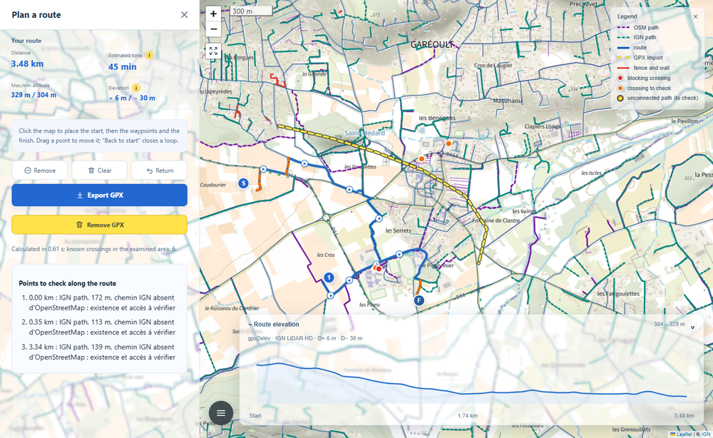
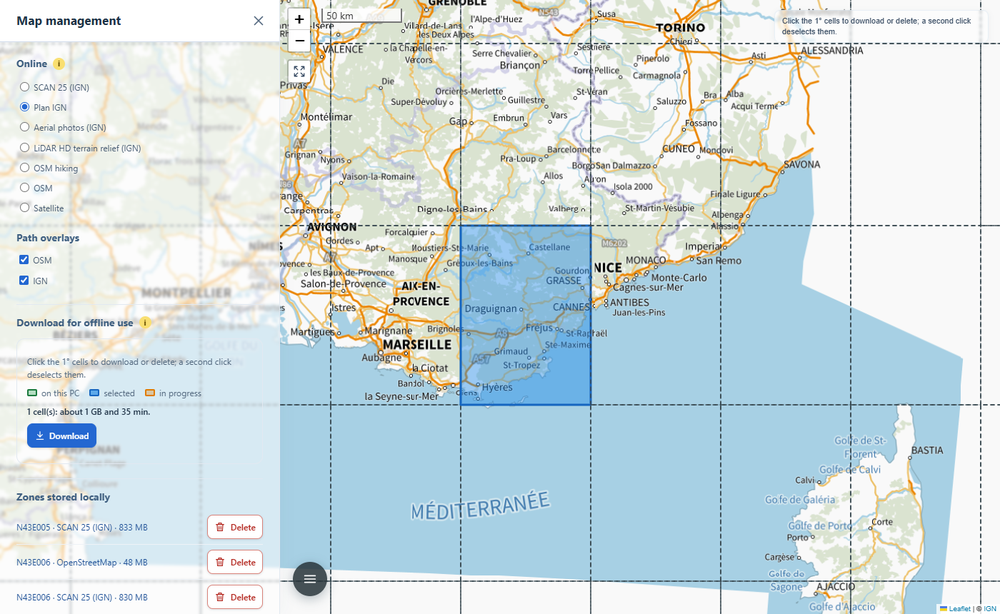
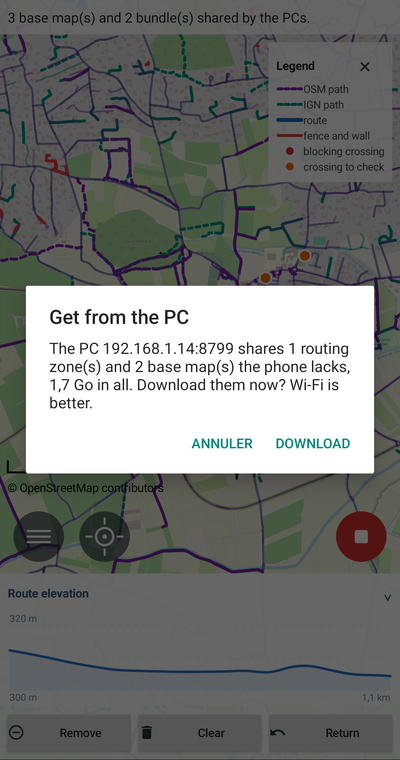
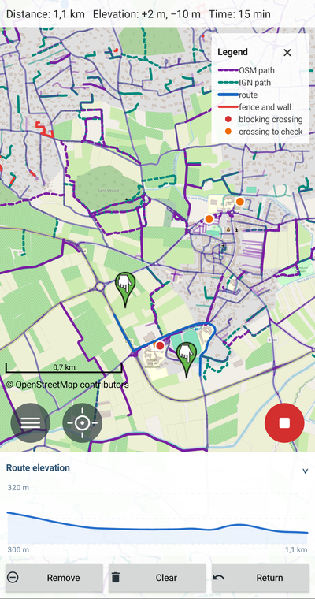

***English** | [Français](README.fr.md)*

# hike2gpx

hike2gpx plans hikes and exports the route as GPX. It comes in two versions
that complement each other: a desktop application (Windows, macOS, Linux) and
an Android application. The computer prepares what the phone carries: it
builds base maps and routing areas, then shares them over Wi-Fi with a QR
code. The phone then computes its routes offline, in the middle of a hike,
with no network.

Three things set it apart from the usual planners (Visorando, Locus Map,
brouter-web).

**It respects the fences, barriers and gates that OpenStreetMap describes.**
These planners do not see them: their routing engines only read the tags on
the nodes of the path, and a fence is a separate line. hike2gpx examines the
network of the area beforehand, finds every crossing between a path and a
barrier, judges it, then forbids or discourages the passage.
([How](#routing-brouter-and-crossings), [a measured example](#the-figures).)

**It combines OpenStreetMap with national maps.** A path that IGN (the French
national mapping agency) knows and OpenStreetMap does not does not exist for an
engine that reads only the latter. hike2gpx adds IGN's BD TOPO (France), ATKIS
(Germany), swissTLM3D (Switzerland), ZABAGED (Czechia) and BDOT10k (Poland).
This is not every country, on purpose: only those where the national map
brings a significant share of new paths are kept.
([How](#what-a-routing-area-holds), [the figures country by
country](#the-figures).)

**It computes elevation on the ground, not on the treetops.** Under a forest, a
surface model such as SRTM or Copernicus, both derived from radar, rather
measures the top of the canopy, and distorts the slopes. LiDAR sends laser
pulses, some of which pass through the foliage to the ground: from them one
builds a true digital terrain model (DTM), the bare ground. hike2gpx takes the
best terrain model that covers the whole route: in France, IGN's LiDAR HD;
elsewhere Mapterhorn, which takes the national LiDAR whenever one exists.
([How](#elevation-recomputed-by-gpx2elev), [the measured
accuracy](#the-figures).)



## How to use it

### Install and relaunch

**On the computer**, download the archive for your system from the
[releases](https://github.com/nico579/hike2gpx/releases), unzip it and run
`hike2gpx`: the page opens in the browser. On the very first launch, hike2gpx
puts an icon on the Desktop; that icon is what relaunches it afterwards, after
the computer restarts for instance.

While it runs, hike2gpx lives in the notification area (near the clock on
Windows, in the menu bar on macOS). Closing the browser tab does not stop it: a
double-click on its icon opens the page again. Its menu offers "Open", "Update
to x.y" when a newer version exists, "Restart", "Stop", and "Create a Desktop
shortcut" to bring the icon back if you deleted it. It updates itself: when a
newer version is published, a banner on the page and that menu offer to
install it; it downloads it, checks it, then restarts on it.

**On the phone**, install `hike2gpx-android.apk`, from the same releases
(Android asks you to allow installs from that source). The app relaunches like
any other, from its icon.

### On the computer

**Plan a route.** Open the menu (the three-line button, bottom left), then
"Plan a route". Each click on the map places a point: the start, the
waypoints, the finish. The route is computed right away, with its distance,
walking time and profile; drag a point to move it. "Return" closes the loop on
the start, "Export GPX" saves it to the Downloads folder.

The dots on the map can be clicked. A red dot (blocking crossing) or an orange
one (to check) opens a bubble that tells what bars the path, a gate, a fence, a
barrier, why hike2gpx judged it so ("access forbidden or private", "locked
gate"…), and a link to the object on OpenStreetMap. A yellow dot marks an
unconnected path: it stops very close to another one without touching it, so
the routing does not pass from one to the other; its bubble gives the gap and
opens the OpenStreetMap editor to fix it.

**Download a map area.** In "Map management", choose the base map to take
along (SCAN 25, Plan IGN, OpenStreetMap…), then click the 1° cells you want on
the map and "Download". Routing areas are taken in "Route management", by 5°
cells; in the five countries with a national map they come ready-made from the
server ([details](#routing-areas)).



**Import a GPX or KML.** The "Import a GPX or KML" entry of the main menu
shows a file on the map, as a landmark, without touching the route. A GPX is
drawn as yellow dashes. A KML keeps the colours and widths of its file, as in
Géoportail: the one [gpx2dash](https://github.com/nico579/gpx2dash) builds with
hundreds of tracks shows at once. A click on a track opens its bubble: its
place, date, distance, elevation gain (gpx2elev's, with its terrain model) and
walking time. The same entry, now "Remove the import", clears it.

**Share it with the phone.** Select the cells already on the computer (in
green) and click "Share": a QR code appears. The phone must be on the same
Wi-Fi. "Stop sharing" closes it, and the code changes every time
([details](#sharing-with-the-phone)).


### On the phone



**Get the map.** In "Map management", tap "Scan the computer's QR code" and
aim at the PC's QR code. The phone says what it is missing and how big it is,
then downloads the base maps and routing areas, each file checked on arrival.
Areas published by the server (France, Switzerland, Germany, Czechia, Poland)
are also offered by themselves, with no PC. On the very first launch, the map
opens on the town given by the IP address (approximate: that of the operator's
connection point). As long as no routing area covers the map, "Plan a route"
stays greyed out: the phone only computes with an area, and says so rather
than failing.

**Plan a route.** Menu, then "Plan a route": each tap on the map places a
point, as on the computer, and the route is computed on the phone, with no
network once the area is installed. The profile panel folds with a tap on its
title. A tap on a red or orange dot opens its details, with the link to
OpenStreetMap. The menu also imports a GPX or KML, as on the computer; a tap
on a track opens its details.

**Record a track.** "Record a track" follows your position during the hike,
screen off included. When you stop, the track goes by itself to Downloads, like
a planned route. [All about the Android app](android/README.md).



<br clear="right">

## How it works

A route goes through four steps.

1. **Prepare**: gather for a region a *routing area*, that is everything the
   routing reads, the path network (OpenStreetMap and national map), the
   terrain and the barriers. A GitHub server builds them every week for the
   five countries with a national map; elsewhere, your PC builds them.
2. **Route**: the BRouter engine searches for the route, with a cut laid across
   every path where a barrier bars it.
3. **Measure**: gpx2elev recomputes the elevation gain and the walking time on
   the best terrain model available.
4. **Carry**: the PC shares routing areas and base maps with the phone, which
   repeats steps 2 and 3 with no network.

The sections below follow these steps, from the routing towards what feeds it.

### Routing: BRouter and crossings

[BRouter](https://github.com/abrensch/brouter), the one Locus Map uses,
computes the route locally, on the computer as on the phone, which embeds it.
hike2gpx does not modify its code, but gives it its own tiles: where a
national map exists, the BRouter site's tiles, built from OpenStreetMap alone,
are replaced by tiles **enriched with the paths of IGN** (or ATKIS,
swissTLM3D, ZABAGED, BDOT10k) **and with LiDAR elevation** (Mapterhorn), the
bare ground, instead of the SRTM behind their slopes
([what they hold](#what-a-routing-area-holds)). The profile is BRouter's
hiking one ("hiking-mountain", the one of brouter-web), corrected on one
point: a pedestrian ban (`foot=no` or `foot=private`) is respected even where
a bicycle could pass or a sidewalk is tagged.

Barriers are not baked into the network: every computation lays them across
the paths. hike2gpx reads from OpenStreetMap the paths usable on foot, the
barriers drawn as lines, the barrier nodes and the waymarked hiking routes,
then judges each crossing **blocking**, **to check** or **passable**
([the rules](#crossing-rules)). Each crossing reaches BRouter as a small
one-metre line laid across the path. Without a weight, it removes the stretch
from the computation; with a weight, it makes it costly, so that a detour of
less than about 300 m avoids it. A blocking crossing is forbidden; a crossing
to check is weighted, or forbidden when "Include crossings to check" is on. If
the route BRouter returns still went through a forbidden cut, hike2gpx would
refuse it instead of showing it; and if there is no route at all, the page says
so, without joining the points in a straight line.

### Routing areas

A routing area covers a 5° by 5° cell (E5_N40, for instance, spans 5° to 10° E
and 40° to 45° N: Provence and Corsica). It holds everything the routing needs,
with no network, each file checked against the SHA-256 fingerprint of a
manifest. One simple rule applies: when an installed area covers the whole
route, it is used alone, for the routing as for the map layers. With no area,
nothing is computed (see [Without a routing area](#without-a-routing-area)).

There are three ways to get one.

- **From the server**, for France, Switzerland, Germany, Czechia and Poland.
  Nothing downloads by itself: when "Plan a route" opens with no area under
  the map, hike2gpx asks whether to download the region's area (it weighs
  several hundred MB). Accepted, it downloads, resumed after a cut, then the
  page opens; the Var cell, 247 MB, arrives in a few tens of seconds. Refused,
  planning does not open. An installed area updates through its "Update"
  button in "Route management". On the PC, where the server publishes
  nothing, planning offers to prepare the area on the PC: the simple area
  first, then the extended area.
- **From the PC**, everywhere else: "Route management" shows the grid of
  cells; click the ones you need, then "Download". The PC prepares the view on
  screen or the whole cell.
- **From BRouter, on the phone alone**, where the server has nothing (Canada,
  Asia…): "Plan a route" offers the base area BRouter publishes for any cell
  of the world (a few tens of MB). Routes are computed with it, without the
  paths drawn on the map nor the crossings to check: for those, the PC
  prepares the complete area and shares it.

A cell you no longer need is removed from its bubble: "Delete from this
computer" erases its routing area and its base maps. An area from the server
downloads again in a few seconds; an area prepared on the computer has to be
built again.

#### What a routing area holds

Its core is an RD5 tile, the format BRouter reads: the path network and the
terrain. The BRouter site publishes some every night, built from OpenStreetMap
alone. Where a national map brings paths, hike2gpx compiles its own, with
BRouter's own tile builder, from three ingredients.

1. **OpenStreetMap**, read from the [Geofabrik](https://download.geofabrik.de/)
   extract of the region.
2. **The paths of the national map**, but only those that duplicate no
   OpenStreetMap way, connected to the network by nodes inserted into the
   neighbouring ways. A 5° cell does not fit in memory at once: the merge runs
   over 0.25° meshes, and a shared register keeps the same nodes at the same
   places from one mesh to the next. These paths cost one and a half times as
   much as an equivalent OSM path, and the route shows them as orange dashes,
   to check: nothing says they still exist or that one may walk them. "Include
   IGN paths" forbids them without changing tiles.
3. **The terrain** of [Mapterhorn](https://mapterhorn.com), the bare ground
   derived from LiDAR where it exists, resampled to one arc second (about
   30 m). The routing thus penalises the slopes of the real ground, not those
   of the treetops in the SRTM that the BRouter site's tiles carry.

Next to the RD5, the area keeps its crossings, judged on the merged network (an
OSM trail and an IGN path that stop on either side of a fence cross it once
connected), and the layers the map shows: paths, barriers, crossings,
unconnected paths.

#### The GitHub server

Every Sunday at 02:17 UTC, GitHub Actions builds the routing areas of the
fifteen cells that cover the five countries with a national map. Each cell has
its own machine, in parallel; the Var cell takes about an hour and a half,
6 GB of memory and 35 GB of disk. A cell whose editions have not changed (OSM
extract, national map) is not rebuilt. A passing failure (Geofabrik
overloaded, a cut) does not lose the cell: each step retries and only redoes
what is missing.

The areas go to the fixed "bundles" release of the
[hike2gpx-bundles](https://github.com/nico579/hike2gpx-bundles) repository,
with their `catalog.json` catalog, which the computer and the phone read. Each
build leaves a timestamped report there in `rapports/`, cell by cell and step
by step, with the cause of each failure. The logic lives in this repository
([workflow](.github/workflows/bundles.yml)), next to the code it runs; it goes
through the [command line](#command-line).

#### Outside the server's countries: the PC builds

For Spain, Italy, Norway or anywhere else, the server publishes nothing: your
PC prepares the area. Without a national map there is nothing to compile: the
RD5 is the BRouter site's, and the PC only adds the crossings and the layers,
taken from the OpenStreetMap extract it downloaded. A view of a few kilometres
is ready in about three minutes. The area is then shared with the phone like a
base map.

#### Without a routing area

With no area installed, nothing is computed on the fly: no route, and no paths
drawn on the map. "Plan a route" then offers the area, downloaded from the
server when it publishes one, otherwise prepared on the PC. The preparation
starts with the simple area from brouter.de, which is enough to route and
arrives in about a minute. The extended area, with its paths and crossings, is
then built in the background from the Geofabrik extract of the region, cropped
to the cell. Extracts renew with their area, after the delay chosen in the
settings (30 days by default).

An unknown barrier never proves that a passage is free: a tile without data
stops the build instead of passing for empty.

### Elevation, recomputed by gpx2elev

The elevation gain BRouter gives comes from the terrain of its tiles. Once the
route is drawn, hike2gpx recomputes it with the
[gpx2elev](https://pypi.org/project/gpx2elev/) engine, following its published
protocol:

1. the track is sampled every 5 m;
2. the altitude of each point is read from the best terrain model that covers
   **the whole** route, in this order: IGN LiDAR HD, Mapterhorn, FABDEM,
   Copernicus GLO-30, SRTM. One model for the whole track, never a mix, so that
   a seam between two models does not create a step;
3. the profile is smoothed by a 20 m Gaussian, which wipes out the model's
   noise without flattening a real bump;
4. ascents and descents are counted with a 2 m hysteresis: a change only enters
   the total once it exceeds 2 m in the same direction. A path that undulates
   by one metre over a kilometre therefore does not add a hundred metres of
   imaginary climb.

The walking time follows Tobler's model, applied to the profile in 20 m steps:
the speed is 6 × e<sup>−3.5 × |slope + 0.05|</sup> km/h, about 5 km/h on the
flat, a little more on a gentle descent, much less on steep slopes. While
gpx2elev computes, BRouter's figure serves as an estimate; if no model covers
the route, the elevation gain is reported as unavailable rather than replaced
by that figure.

### Maps

**Online**, the map follows the country of its centre and offers its base
maps: everywhere OpenStreetMap, OSM hiking and a satellite view; in France the
SCAN 25 (with an IGN key), Plan IGN, aerial photos and the LiDAR HD relief;
elsewhere the national map of ten other countries (Spain, Switzerland,
Germany, Austria, the Netherlands, Luxembourg, Norway, Poland, Czechia, the
United States). Each country has its file
`hike2gpx/assets/web/providers/<country>.js`: base maps, layers, styles and
labels. The five countries whose paths feed the routing also have a reader in
`hike2gpx/providers/`: BD TOPO by region, ATKIS (the WFS of Bavaria and
Thuringia, elsewhere the vector tiles of
[basemap.de](https://basemap.de/produkte-und-dienste/web-vektor/)), swissTLM3D
and ZABAGED in their national edition, BDOT10k by district. The
[table of supported countries](RAPPORT_SOURCES_CHEMINS_BROUTER.md#pays-pris-en-charge)
is generated from these files.

**Offline**, for the phone, "Map management" prepares base maps by 1° cells.
The tiles of the base maps whose licence allows it (SCAN 25, Plan IGN, photos,
LiDAR relief) are stored as MBTiles: around Garéoult, a view at zoom 16 is 631
tiles, 12 MB in SCAN 25; a whole cell stops at zoom 13 (151 MB in SCAN 25,
about three quarters of an hour, because hike2gpx spares IGN's service).
OpenStreetMap forbids bulk copying of its tiles: the PC therefore builds, from
the Geofabrik extract, a vector map in the Mapsforge format (the one of Locus
Map), which the phone draws itself. OSM hiking and the satellite view stay
online. The SCAN 25 is not open data: a base map stays on your PC and your
phone, it is never published.

### Sharing with the phone

The phone version automatically downloads the routing areas of the server on
GitHub. The computer version builds the routing areas for the countries
outside the server, and the base maps, then shares them with the phone over
Wi-Fi.

Sharing is closed until you open it. Open, it only listens on the local
network, serves only what you selected, and its code changes every time; each
file is checked against its fingerprint on arrival and resumed after a cut. On
Windows, hike2gpx creates by itself, on the first share, the firewall rule
that lets the phone in, after a single administrator authorisation request.
The protocol is described in
[docs/architecture/partage-telephone.md](docs/architecture/partage-telephone.md).

### Exporting and importing a zip archive

Without a shared Wi-Fi, cells travel in a zip archive, on a USB stick, a
Drive or as an attachment. On the PC, select cells that are present (in green)
and click "Export": the browser saves the archive. On the phone, "Export to an
archive (zip)", in "Map management" or "Route management", lets you tick the
maps or areas, then choose where to save it. The other way, "Import", on the PC
as on the phone, installs everything the archive holds.

The archive thus goes from one PC to another, from a PC to a phone, or from
one phone to another. A friend with a less powerful PC gets your maps without
building them again, then shares them with their phone. It is also a backup: a
SCAN 25 cell takes over an hour to download, its archive imports again in a few
minutes.

The archive is the phone share put in a zip: the same catalogue, where each
file carries its size and SHA-256 fingerprint, checked before installing. A
damaged file is refused.


### Choosing where the data is stored

Maps, routing areas, OSM extracts, relief: downloaded data quickly weighs
several GB. On the PC, the settings show the data folder; enter another one,
on a bigger disk, then "Move". The whole folder is copied, preferences and
logs included, with its progress in the activity row; hike2gpx then restarts
on the copy and deletes the old folder. Only a small file, `emplacement.json`,
stays at the standard location and leads to the new one. If the disk is
unplugged, hike2gpx notes it in its log and falls back to the standard
location.

On the phone, the settings offer the phone storage or the SD card, with the
free space of each. Maps, routing and relief move there; if the SD card is
removed, hike2gpx says so and falls back to the phone storage.

### Crossing rules

Each crossing between a path and a barrier is judged with the rules of
[gpx2elev](https://github.com/nico579/gpx2elev), copied as they are into
`regles.py`: a fence crossed with no mapped opening blocks, a gate with no
access information is to check, `foot=yes` wins over `access=private`, opening
hours or conditions leave a doubt.

hike2gpx adds what a whole network allows, which a single track does not show:

- a barrier that ends on a path, or touches it and leaves on the same side,
  does not cross it; nor does a path on a bridge or in a tunnel;
- a barrier that ends less than 2 m from the path can be walked around;
- a gate set on the fence close to the path, without being carried by it, is
  judged as if it were: locked or private, it does not make the fence passable;
- two different levels (`layer`) make the crossing "to check";
- a waymarked trail necessarily goes through somewhere: a barrier that would
  block it becomes "to check" there.

When two cuts fall on the same stretch, the forbidden one always wins over the
weighted one.

## The application in detail

The desktop page and the Android app have the same screen: the map first, full
screen, and a three-line button, bottom left, that opens the menu ("Search",
"Map management", "Route management", "Import a GPX or KML", "Plan a route", "Settings", "Help"; on
the phone, also "Record a track"). On the computer, each entry opens a panel on
the left, which its cross closes; the menu also holds the FR/EN choice and a
light that says whether the next routing has what it needs. "Help" opens this
guide, in the page's language. What is specific to the phone is in
[android/README.md](android/README.md).

**The map and the legend.** The base map and the layers are chosen in "Map
management". Two layers, from an adjustable zoom, show the paths: those of
OpenStreetMap (trails as dashes), with the fences, walls and crossings it maps;
and those of the national map. The legend, top right, only shows what is on
screen; its cross hides it. "Search" centres the map on a town (the French
state's Géo API in France, Nominatim elsewhere) or on GPS coordinates. A right
click shows the coordinates of a point and lets you copy them.

**The routing options**, in "Route management":

- **Include crossings to check**: also avoid the passages "to check", not only
  the blocking ones;
- **Include IGN paths** (ATKIS in Germany…): let the routing use the paths of
  the national map that OpenStreetMap lacks;
- **Compare with the standard route (which ignores barriers)**: overlay, as a
  grey dotted line, the route of BRouter's standard profile, with its length
  and the blocking crossings it goes through. It is never exported.

**The result.** A summary gives the distance, the estimated walking time, the
elevation gain and the extreme altitudes. The elevation profile unfolds at the
bottom of the map, with the name of the terrain model; hovering it shows the
point on the route. The crossings to check are listed, each with a link to
OpenStreetMap. "Export GPX" saves the route, with these points as waypoints.
A GPX or KML imported from the menu shows as a landmark, without touching the
route or the export.

**The settings.** The IGN key for the SCAN 25 (without it, Plan IGN, under the
Open Licence), the renewal delay of the data (30 days by default), the zoom
from which the layers are drawn, the transparency of the panels, "Show the
legend", a button that empties all caches, another that opens the logs, and
the installed version with "Check for updates". They are saved when the panel
closes. The page finds again, when reopened, the view, the base map, the
layers, the options and the route of the previous time.

## The figures

**Barriers.** In Garéoult (Var, France), BRouter's standard hiking profile goes
through a concrete fence on a 69 m stretch; hike2gpx goes around it with a
435 m detour. The option "Compare with the standard route" shows that
difference on the map. The full test is in [ESSAI.md](ESSAI.md).

**National maps.** On the areas studied, BD TOPO adds 18% to 100% in length of
candidate paths, ATKIS 12% to 127%, ZABAGED 40% to 66%, while the United States
and the Netherlands stay between 0% and 12%: that is why these two countries
have no enriched routing area. These percentages measure possible lengths, not
a guaranteed gain: the method and its caveats are in
[RAPPORT_SOURCES_CHEMINS_BROUTER.md](RAPPORT_SOURCES_CHEMINS_BROUTER.md).

**Terrain.** Mapterhorn gathers about two hundred national and regional models,
at 0.25 m to 10 m resolution, for almost all of Europe, the United States,
Canada, Japan, Australia and New Zealand. Outside these areas, hike2gpx falls
back on Copernicus' 30 m global model, which is less precise, and SRTM remains
the very last resort. Compared with the native LiDAR, Mapterhorn differs by 1.6
to 3 cm (RMSE) from IGN's LiDAR HD terrain model on three French areas, and by
10 cm from the DGM1 on one Saxon site: negligible for an elevation gain, which
the 20 m smoothing averages out anyway. These measurements, with their limits,
are in
[lidar2map's evaluation](https://github.com/nico579/lidar2map/blob/main/docs/mapterhorn-evaluation.fr.md),
the sister project, whose
[provider catalog](https://github.com/nico579/lidar2map/blob/main/docs/providers.md)
gives the detail country by country.

## Command line

The desktop version can also be driven from the command line; the page and the
routing-area server go through the same code. Run without arguments,
`hike2gpx` acts as `hike2gpx serve`.

| Command | Role |
|---|---|
| `hike2gpx serve [--port N] [--sans-navigateur] [--sans-icone]` | Opens the page (default). Without browser nor icon, it only serves the page, for instance on a headless machine. |
| `hike2gpx installer [CELLS…]` | Installs BRouter 1.7.10 (archive checked against its fingerprint) and the requested BRouter tiles, for instance `E5_N40`. |
| `hike2gpx analyser SOUTH WEST NORTH EAST` | Counts and judges the crossings of an area, without routing. |
| `hike2gpx bundles CELLS… --output FOLDER` | Builds the routing area of each cell, like the page. See below. |
| `hike2gpx catalog FOLDER [--publish-dir PUB]` | Writes the `catalog.json` of the built areas (size, SHA-256, address of each file); with `--publish-dir`, prepares a GitHub release. |
| `hike2gpx cells [--provider P] [--bulk-only]` | Lists the 5° cells that the countries of the national maps touch: the ones the server builds. |
| `hike2gpx freshness CATALOG [--cells C] [--max-age D]` | Checks the age of the areas of a catalog; fails if a cell is missing or an area is older than `D` days (14 by default). |
| `hike2gpx report JOBS [--catalog C] [--cells C] [--run-url U] [--ref R]` | Writes, in Markdown, the report of a server build. |
| `hike2gpx firewall --program EXE` | Opens the Windows firewall to sharing with the phone (as administrator; the page does it by itself on the first share). |

The options of `bundles`:

- `--provider P` (repeatable): the national map to merge, among `ign`,
  `atkis`, `swisstlm3d`, `zabaged`, `bdot10k_ds`; by default, every one whose
  country touches the cell;
- `--osm-only`: an OpenStreetMap-only area, without any national map;
- `--bulk`: read each national map from its bulk download (BD TOPO regional
  GeoPackages, needs the `7z` command) rather than its web service, the only
  reasonable way to build a whole cell;
- `--gpkg FILE` and `--department 83`: read BD TOPO from an already downloaded
  GeoPackage, limited to one department;
- `--zone SOUTH WEST NORTH EAST`: limit every cell to an area;
- `--force`: rebuild up-to-date areas too (after a change of build rules);
- `--stage data|compute|layers|finish` and `--part I/K`: split a build over
  several machines, like the server.

An up-to-date area is skipped, and a failing cell does not stop the others. The
server chains:

```
hike2gpx cells --bulk-only                          # the cells to build
hike2gpx bundles E5_N40 E5_N45 --bulk --output areas/
hike2gpx catalog areas/ --publish-dir release/
hike2gpx freshness release/catalog.json --cells "E5_N40 E5_N45"
```

## Limits

hike2gpx can only avoid what is mapped. Around Garéoult, over 250 km²,
OpenStreetMap records only 18 fences, and IGN's BD TOPO none (see
[ESSAI.md](ESSAI.md), in French). A fence found in the field and added to
OpenStreetMap is respected by hike2gpx as soon as its cache of the area is
renewed; the engines of the other planners keep ignoring it.

Outside France, Germany, Czechia, Switzerland and Poland, routing
only knows OpenStreetMap's paths: a trail missing from OSM does not exist for
it, even if the national map draws it. The integrated ATKIS ways do not state explicit pedestrian
rights, so any routed section must be checked on site.

A computation examines at most 100 tiles of 0.05°, about 55 × 40 km: the first
reading of a larger area would take tens of minutes. A long route is split
into stages.

## Installing from source

From source, you need Python 3.12, [uv](https://docs.astral.sh/uv/) and
Java 11 or later for BRouter.

```
uv venv --python 3.12 .venv
uv pip install --python .venv\Scripts\python.exe -e ".[test]"
.venv\Scripts\hike2gpx installer E5_N40
.venv\Scripts\hike2gpx serve
```

`installer` downloads BRouter 1.7.10 (archive checked against its SHA256
digest) and a data tile, here E5_N40, which covers Provence, from 5° to 10° E
and from 40° to 45° N. From the page, there is nothing to do: the engine
installs itself on first launch, and each data tile downloads in the
background as soon as a computation needs it, anywhere in the world, the
computation resuming when it arrives. The data goes into the standard state
folder (`%LOCALAPPDATA%\hike2gpx-data` on Windows), or the one named by the
`HIKE2GPX_HOME` variable.

The SCAN 25 is not open data: it needs an IGN key, entered in the page
settings. Without a key, the map uses the IGN Plan, under the Licence Ouverte
(the French open licence). The other base maps need no key.

## Tests

```
.venv\Scripts\python.exe -m pytest
```

The unit tests run without network or BRouter. `test_regles.py` compares
`regles.py` with its source in gpx2elev when that repository is on the
machine. `test_integration.py` replays a real case from Garéoult with the
actual BRouter: it is skipped as long as BRouter and its E5_N40 tile are
missing from the data folder, and runs in a few seconds with
`$env:HIKE2GPX_HOME = 'D:\hike2gpx'`. `test_integration_maison.py` builds a
home-made tile with the actual tile builder, on a small invented network where
two OSM paths only meet through IGN paths; it also needs BRouter's build
profiles, which the first build from the page downloads into the data folder.
`test_integration_securite.py` checks in the same way, on six invented cases,
that the profile and the order of the cuts respect the prohibitions.
`test_page.py` runs the page under Node, when Node is installed; it also
checks that every country in `providers/` has its labels in French and
English. The tools in `tools/` replay the trial described in
[ESSAI.md](ESSAI.md) (in French) and the measurement of the path sources.

## Building the program

```
python build.py --archive
```

`build.py` creates an isolated environment, fills it from the
`requirements-build.txt` lock file (exact versions and digests, PyInstaller
included), downloads the Temurin 21 JRE for this system while checking the
digest Adoptium publishes, builds the program with `hike2gpx.spec`, then runs
its self-test (`--self-test-version`): embedded Java, pyosmium, rasterio, page.
With `--archive`, it packs the published archive and its `.sha256`, under the
name the shared library's automatic update expects. The frozen program only
uses its own Java; from source, hike2gpx uses the system's. On GitHub,
`release.yml` does the same on the four systems for every tag, and on every
pull request that touches the program. On macOS, it needs macOS 15 or later,
as do the rasterio wheels.

The lock files are regenerated with uv:

```
uv pip compile pyproject.toml --universal --python-version 3.12 --generate-hashes -o requirements.txt
uv pip compile requirements-build.in --universal --python-version 3.12 --generate-hashes -o requirements-build.txt
```

## License

GPL-3.0-or-later. BRouter (MIT) is downloaded at installation; Leaflet 1.9.4
(BSD-2-Clause) is shipped in `hike2gpx/assets/web/leaflet`. The published
program embeds Eclipse Adoptium's Temurin 21 JRE (GPL-2.0 with the Classpath
exception, texts in `_internal/jre/legal`). Data © OpenStreetMap contributors
(ODbL), including the test extract `tests/donnees/gareoult_cloture.json`;
BD TOPO © IGN (Licence Ouverte); maps © IGN, and for the national base maps,
© each agency, as credited on the map.
